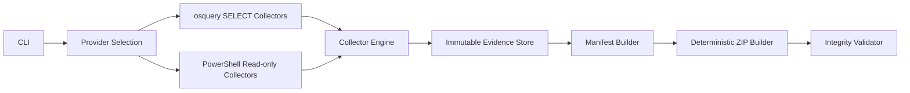
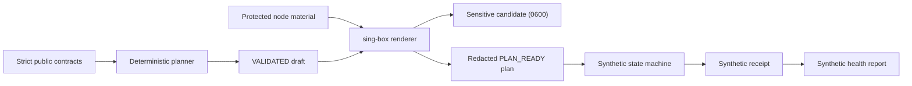
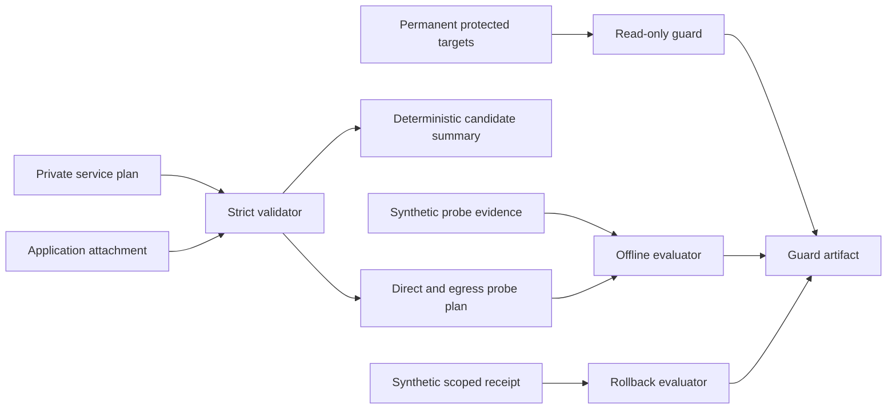
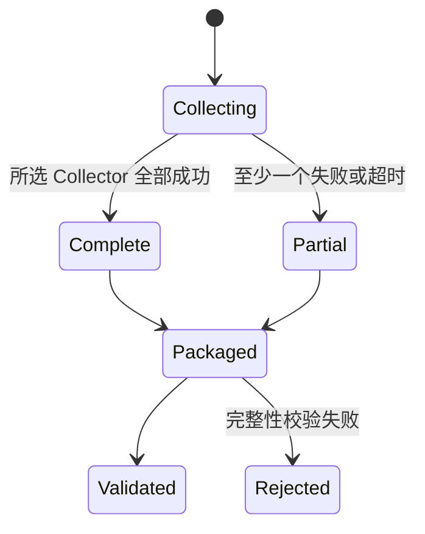
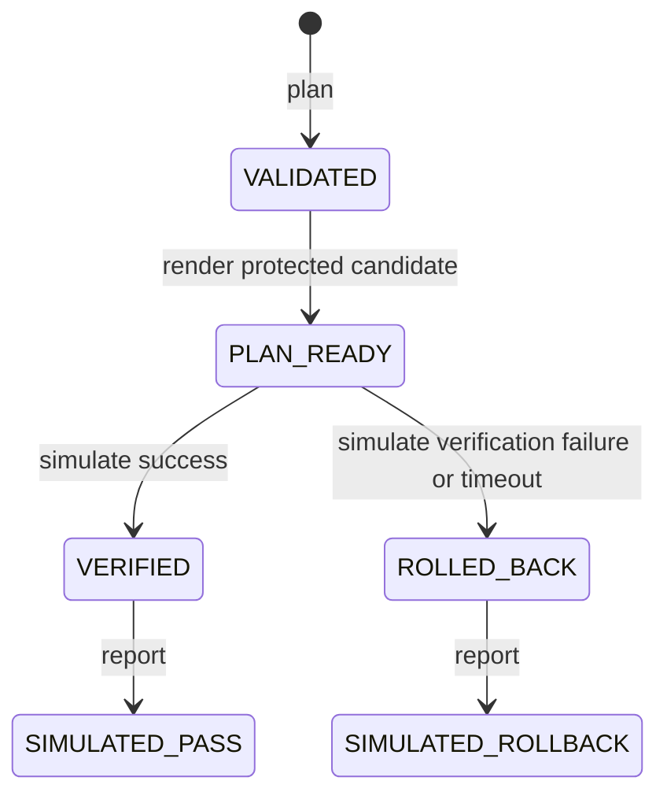

# System Design Description

## 1. 目标

CND 的 `cnd.exe` 把一次主机观察转换为可独立校验的 Evidence ZIP。该路径按
“Provider → Collector Engine → Evidence Store → Manifest → Deterministic ZIP → Validation”单向流动，
不存在修复回路。独立的 `cnd-network` 使用另一条 simulation-only 路径，不改变 Evidence Engine。

## 2. 模块

### CLI

命令为 `collect`、`validate`、`catalog` 和 `version`。CLI 负责参数和退出码，不包含采集逻辑。

### Provider Selection

`auto` 优先选择显式路径或 PATH 中的 `osqueryi.exe`，否则选择 `powershell.exe`/`pwsh.exe`。显式 Provider 不可用时直接失败，不偷偷更换实现。

### Collector Engine

Engine 顺序执行当前目录，给每个采集器创建独立超时上下文。顺序执行避免多个系统枚举同时竞争 WMI、CIM 或 IP Helper 资源。失败被记录后继续。

### Evidence Store

Store 只接受相对安全路径，并以 `O_EXCL` 创建文件。绝对路径、卷路径、根路径、`..` 逃逸和重复写入都会被拒绝。

### Manifest

Manifest 保存工具版本、主机名、采集窗口、完整/部分状态、Collector 结果及文件 SHA-256。Collector 与文件在序列化前按稳定键排序。

### ZIP Builder

ZIP 条目按名称排序，时间固定为 1980-01-01，文件与目录权限固定。目录条目显式存在。ZIP 本身的 SHA-256 在命令摘要中返回。

### Validator

Validator 检查：

- 不安全路径和重复条目。
- 必需目录及文件。
- Manifest JSON 与 Schema 版本。
- Manifest 重复路径。
- 缺失、额外、大小不符或 SHA-256 不符的文件。
- 单文件 256 MiB 校验上限。

### Ubuntu Network Core

`internal/networkcore` 保存不含任意 map 的严格领域合同、验证器、确定性规划器、状态机和报告构造器。
`internal/networkengine/singbox` 是 sing-box `1.13.12` 适配器；只有该适配器接触受保护节点材料，
并把材料渲染到新建的 candidate 文件。`internal/networkcli` 只负责参数、文件状态门和退出码。

候选配置中的管理规则位于隧道规则之前，最终出口为 `direct`。规划器在离线状态下检查域名后缀、
协议、端口和 CIDR 重叠，不执行 DNS 或任何网络 I/O。

### Application Private Egress Contract

v0.4.0 在 `internal/networkcore` 内增加独立的严格类型，不复制中国出口与全球出口实现：

`ContinuityPlan` 拥有 workload、稳定 route identity、私有 endpoint、consumer allowlist、credential
reference、有界超时、失败策略、candidate 摘要、probe/receipt/rollback domain 和全为 false 的宿主
网络影响声明。`ApplicationAttachment` 只绑定一个 consumer 的显式业务选择器，并把回滚限制为
detach 该 attachment、恢复 `direct`。

`lcsp-continuity-b` 与 `lcnd-egress-cn` 通过 workload-specific endpoint、credential、probe、receipt、
rollback 和 inbound tag 隔离。旧公网 TCP/443/HAProxy→Caddy/Xray/客户端线路只作为永久保护目标，
不进入候选生成或执行路径。

## 3. 数据状态

### Ubuntu Live Health (v0.5.0)

`internal/networkhealth` 独立拥有严格输入、Linux固定只读事实、真实串行探针、分路径评价与中文报告。
`internal/networkcli/diagnose.go` 只在显式`diagnose`入口调用它；其余离线命令不增加网络副作用。
`DNS -> TCP -> TLS -> HTTPS HEAD` 每轮共享截止时间，额外总预算120秒；HEAD不跟随重定向或读取正文。
direct忽略环境代理；proxy使用明确私网IP端点，目标DNS标记不可观测，不静默回退。
主机文件最大64KiB，输入最大1MiB，响应头最大32KiB；两个报告在网络操作前独占创建。
真实报告独立于synthetic schema，成功率以可观测适用层为分母，blocked下游不算成功；完整失败有评分，
缺失/取消证据score=null。主机观察完整性与路径分数独立呈现。详见RFC 0005。

`partial` 是合法证据包状态，不等同于 ZIP 无效。ZIP 有效只说明结构和已记录内容一致。

Ubuntu Network Core 使用独立状态：

这些状态全部是合成状态，不映射到真实服务状态。

## 4. 错误处理

- 命令执行失败：保留 stdout/stderr，Collector 标为 `failed`。
- 超时：外部进程由上下文终止，Collector 标为 `timed_out`。
- Evidence Store、Manifest、ZIP 或 Validator 失败：整个命令返回非零。
- 已有输出：默认拒绝；`--force` 才可覆盖。
- `cnd-network` 公共输出与 candidate 均使用 `O_EXCL`，不提供覆盖开关。
- `cnd-network` 将文件错误收敛为角色和稳定代码，不回显输入内容或节点材料。
- v0.4.0 合同输入限制为 1 MiB，严格拒绝未知字段和尾随 JSON；生成摘要、probe、evaluation、guard、
  rollback decision 与 attachment 同样使用确定性 JSON 和 `O_EXCL`。
- continuity 文件读取失败返回 1，已有输出或写入失败返回 1，参数与合同违规返回 2。

## 5. 安全设计

- osquery 禁用事件、扩展和日志，避免后台状态及第三方扩展。
- PowerShell 不使用 `ExecutionPolicy Bypass`。
- 默认目录不包含联网探测或配置写入命令。
- 证据和暂存目录以仅当前用户权限创建；最终组织级 ACL 由部署环境负责。
- Ubuntu 节点描述只保存 `lcnd-secret://` 引用；节点材料和 candidate 是敏感资产。
- 最终 plan、render summary、receipt、report、stdout/stderr 和错误不得包含节点材料。
- v0.3.0 不包含 sudo、systemd、引擎安装、真实节点或生产网络命令。
- v0.4.0 不包含 apply、deploy、网络 I/O 或进程启动；不调用 sudo、systemd、ip、nft、iptables、
  route、resolvectl、tailscale、docker、ssh、curl 或 wget。
- 服务 endpoint 只能为 loopback 或带批准引用的私网；默认路由、全局 DNS/hosts、防火墙、系统代理、
  Tailnet 和整机 TUN 影响字段必须为 false。
- Probe evaluator 只接受 synthetic evidence，至少需要 direct 与 egress 各三个样本；所有结果固定
  `production_healthy=false`。

## 6. 已知限制

- 主机名和时间来自可能不可信的被调查主机。
- CND 没有硬件根信任或远程证明。
- 当前没有内建加密、数字签名、GUI、EventLog 时间线或 WFP/ETW 持续捕获。
- ZIP 构建当前按文件读取到内存；超大事件日志应由未来流式 Artifact 类型实现。
- Ubuntu Network Core 当前只支持 `ubuntu-24.04` / `amd64` 目标和 sing-box `1.13.12` 配置形状。
- 旧工作流健康报告仍为 `evidence_mode=synthetic`；v0.5.0独立`diagnose`报告使用live证据。
  LCSP适配和生产执行仍未实现，Ubuntu吞吐测速/逐跳定位未包含。
- v0.4.0 只发布 LCapi 消费合同，没有修改或验证 LCapi；没有完成 LCSP 托管、秘密注入、真实回执、
  真实节点、真实业务 probe 或生产验收。
- 仓库实现完成不等于 LCSP 接入完成，不等于 LCapi 接入完成，也不等于生产验收完成。
