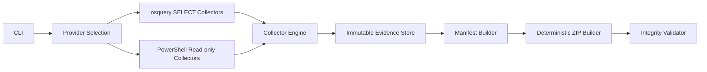
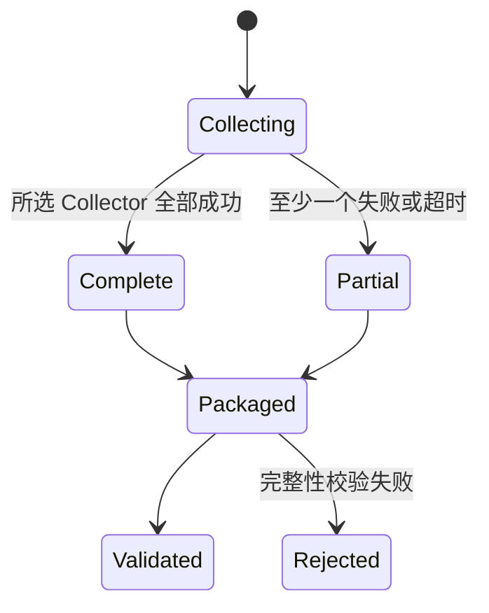

# System Design Description

## 1. 目标

CND 把一次主机观察转换为可独立校验的 Evidence ZIP。系统按“Provider → Collector Engine → Evidence Store → Manifest → Deterministic ZIP → Validation”单向流动，不存在修复回路。

## 2. 模块

### CLI

命令为 `collect`、`validate`、`catalog` 和 `version`。CLI 负责参数和退出码，不包含采集逻辑。

### Provider Selection

`auto` 优先选择显式路径或 PATH 中的 `osqueryi.exe`，否则选择 `powershell.exe`/`pwsh.exe`。显式 Provider 不可用时直接失败，不偷偷更换实现。

### Collector Engine

Engine 顺序执行当前目录，给每个采集器创建独立超时上下文。顺序执行避免多个系统枚举同时竞争 WMI、CIM 或 IP Helper 资源。失败被记录后继续。

### Evidence Store

Store 只接受相对安全路径，并以 `O_EXCL` 创建文件。绝对路径、卷路径、根路径、`..` 逃逸和重复写入都会被拒绝。

### Manifest

Manifest 保存工具版本、主机名、采集窗口、完整/部分状态、Collector 结果及文件 SHA-256。Collector 与文件在序列化前按稳定键排序。

### ZIP Builder

ZIP 条目按名称排序，时间固定为 1980-01-01，文件与目录权限固定。目录条目显式存在。ZIP 本身的 SHA-256 在命令摘要中返回。

### Validator

Validator 检查：

- 不安全路径和重复条目。
- 必需目录及文件。
- Manifest JSON 与 Schema 版本。
- Manifest 重复路径。
- 缺失、额外、大小不符或 SHA-256 不符的文件。
- 单文件 256 MiB 校验上限。

## 3. 数据状态

`partial` 是合法证据包状态，不等同于 ZIP 无效。ZIP 有效只说明结构和已记录内容一致。

## 4. 错误处理

- 命令执行失败：保留 stdout/stderr，Collector 标为 `failed`。
- 超时：外部进程由上下文终止，Collector 标为 `timed_out`。
- Evidence Store、Manifest、ZIP 或 Validator 失败：整个命令返回非零。
- 已有输出：默认拒绝；`--force` 才可覆盖。

## 5. 安全设计

- osquery 禁用事件、扩展和日志，避免后台状态及第三方扩展。
- PowerShell 不使用 `ExecutionPolicy Bypass`。
- 默认目录不包含联网探测或配置写入命令。
- 证据和暂存目录以仅当前用户权限创建；最终组织级 ACL 由部署环境负责。

## 6. 已知限制

- 主机名和时间来自可能不可信的被调查主机。
- CND 没有硬件根信任或远程证明。
- 当前没有内建加密、数字签名、GUI、EventLog 时间线或 WFP/ETW 持续捕获。
- ZIP 构建当前按文件读取到内存；超大事件日志应由未来流式 Artifact 类型实现。
