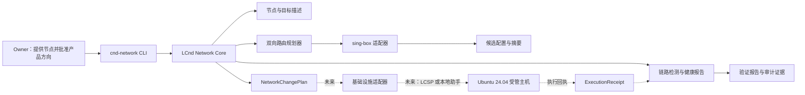

# LCnd Ubuntu 双向网络核心设计

- 日期：2026-08-12
- 状态：`OWNER_DIRECTION_CONFIRMED / USER_REVIEW_PENDING`
- 当前产品版本：`0.2.0`
- 首个服务器基线：Ubuntu 24.04 LTS
- 当前设计范围：LCnd 独立能力；LCSP 集成仅记录边界，暂不实施

## 1. 产品宪法

LCnd 是网络产品与网络服务的责任主体。它负责网络观察、健康判断、
节点与路由策略、连接引擎适配、变更计划、结果验证和产品版本演进。

LCSP 是未来可选的基础设施提供方。它可以在受管服务器上提供资源登记、
冲突检查、特权代执行、服务器级备份、回滚保护和审计，但不得替 LCnd
选择节点、制定路由策略、定义健康标准或决定 LCnd 的产品路线。

用户负责提供合法、可用、已授权的连接节点。LCnd 不购买、生成、销售或
公开节点，不把节点凭据、订阅地址或密钥写入 Git、日志或诊断报告。

sing-box 是首个服务器端连接引擎，不是 LCnd 产品本身。LCnd 必须通过适配器
使用它，避免把产品合同绑定到单一第三方实现。

## 2. 问题与目标

LCnd 当前已经具备 Windows 被动证据采集、显式 v2rayN TUN 修复、回滚和
分层网速检测。新的产品方向是在保留这些安全边界的基础上，为服务器和终端
提供跨地域网络健康与连接治理。

目标场景是双向统一设计：

1. 海外 Ubuntu 服务器访问国内服务时，指定国内目标经中国方向节点，其余流量直连。
2. 国内 Ubuntu 服务器访问海外服务时，指定海外目标经海外方向节点，其余流量直连。
3. Windows 终端未来继续通过 v2rayN 适配器接入同一策略模型。
4. LCnd 对每条路径独立检测、评分、规划、验证和记录，不把单次测速等同于根因。

首个真实业务试点将优先服务“海外 LCAPI 服务器访问国内模型 API”，但领域模型、
路由合同和测试从第一天就必须支持反向策略。

## 3. 已确认决策

- 服务器统一以 Ubuntu 24.04 LTS 为首个支持基线。
- 首版使用独立 CLI、配置文件和机器可读报告，不建设 Web 控制台。
- sing-box 作为首个服务器端连接引擎候选。
- 节点由 Owner 提供；LCnd 只消费节点描述和秘密引用。
- 双向采用同一领域模型，以不同路由策略表达，不复制两套实现。
- `cnd.exe` 继续保持被动证据采集合同，不加入隐式网络修复。
- Ubuntu 网络能力使用独立二进制 `cnd-network`，避免混淆被动采集器。
- LCnd 是服务责任主体；LCSP 仅作为未来基础设施执行适配器。
- LCSP 当前升级完成前，不修改 LCSP 仓库、不冻结其实现接口、不接入生产执行。
- 首个实现切片只做本地合同、规划、渲染、验证和模拟，不使用 sudo、不修改本机网络。

## 4. 方案比较

### 方案 A：LCnd 直接长期持有 root

实现最短，但 LCnd 的检测、策略、第三方引擎管理和特权执行耦合在一起。
一个普通缺陷可能造成路由锁死或远程服务器失联，不适合作为正式架构。

### 方案 B：LCnd 产品核心 + 可替换基础设施适配器（选定）

LCnd 生成严格结构化的计划和验证要求。独立环境可使用本地最小特权助手；
LCSP 受管服务器未来使用 LCSP 适配器代执行。两个执行方式必须消费同一合同。

### 方案 C：把 LCnd 吸收到 LCSP

会让基础设施平台拥有网络产品决策权，使 LCnd 无法独立部署到普通终端或其他
服务器管理环境，与 Owner 已确认的主次关系冲突，因此拒绝。

## 5. 产品架构图



## 6. 用户、入口与业务旅程

### 6.1 角色

| 角色 | 责任 | 不拥有的决定 |
| --- | --- | --- |
| Owner | 提供节点、确认高风险变更和生产验收 | 不需要编写 sing-box 或 Linux 路由配置 |
| LCnd 操作员 | 检测、生成计划、检查影响、验证结果 | 不直接绕过基础设施权限执行任意 root 命令 |
| LCnd Network Core | 维护网络领域合同和确定性规划 | 不保存明文节点秘密 |
| 基础设施提供方 | 承载、代执行、回滚和审计 | 不选择节点或定义 LCnd 健康结论 |
| 连接引擎 | 按已验证配置转发流量 | 不决定产品策略 |

### 6.2 首版入口

首版唯一正式入口是 `cnd-network` CLI。人类可读输出用于操作员，JSON 输出用于
自动化和未来基础设施适配器。两种输出必须源于同一结果对象。

### 6.3 主业务旅程

```text
登记节点秘密引用
-> 描述目标集合和方向
-> 采集只读主机/链路事实
-> 校验节点与策略
-> 生成候选 sing-box 配置
-> 生成确定性 NetworkChangePlan
-> 人工检查计划
-> 当前切片：模拟执行与验证
-> 未来：基础设施方备份、武装回滚并执行
-> LCnd 独立验证每条路径
-> 提交或请求回滚
-> 生成健康与审计报告
```

## 7. 领域模型

### 7.1 `NodeDescriptor`

描述一个由 Owner 提供的可用出口节点，只包含非秘密元数据：

- `schema_version`
- `node_id`
- `display_name`
- `direction`: `china_egress` 或 `global_egress`
- `engine`: 首版固定为 `sing-box`
- `secret_ref`: 指向外部受保护秘密，不包含秘密值
- `capabilities`: TCP、UDP、IPv4、IPv6 等声明
- `enabled`
- `valid_until`（可选）

节点地址、端口和认证材料可以一并存放于秘密载荷；公开描述和证据中只保留
稳定 ID、能力和不可逆摘要。

渲染可运行的 sing-box 配置时，LCnd 在内存中将秘密载荷注入候选配置，并只允许
写入权限受限的明确目标文件。候选配置本身属于秘密资产；它不得写入 Git、stdout、
计划、回执或健康报告。首个切片只使用运行时生成的合成秘密验证这一边界。

### 7.2 `TargetSet`

表达需要特殊出口的业务目标：

- 稳定目标集 ID 和版本；
- 域名、域名后缀、IP CIDR、端口和协议条件；
- 目标用途和负责人；
- DNS 解析策略；
- 禁止包含秘密查询参数或认证信息。

### 7.3 `RouteProfile`

首版提供两个对称模板：

- `domestic_direct_global_tunnel`
- `global_direct_domestic_tunnel`

每个 Profile 明确默认出口、特殊目标集、节点引用、DNS 行为、失败行为和
必须直连的管理目标。任何全局接管都必须显式声明，不能由缺省值产生。

### 7.4 `NetworkChangePlan`

LCnd 生成的不可变计划，至少包括：

- 计划 ID、Schema 版本、创建工具版本；
- 输入描述文件摘要和秘密引用摘要；
- 目标平台和连接引擎版本约束；
- 计划动作及其顺序；
- 管理路径保护条件；
- 候选配置摘要；
- 前置检查、验证探针、成功标准；
- 回滚触发条件和超时时间；
- 是否允许执行；首个切片始终为 `simulation_only=true`。

### 7.5 `ExecutionReceipt`

未来由基础设施提供方返回：

- 计划 ID 和候选配置摘要；
- 执行方、目标主机引用和时间；
- 每个动作的状态与安全错误码；
- 备份、回滚武装和提交状态；
- 非秘密主机事实与日志摘要；
- 禁止包含节点凭据、环境变量和完整秘密文件。

### 7.6 `NetworkHealthReport`

由 LCnd 独立产生，不依赖执行方的“命令成功”结论：

- DNS、TCP、TLS、HTTP 和吞吐/时延证据；
- direct 与 tunnel 路径的分开结果；
- 样本数、时间窗和置信条件；
- 健康等级与有限范围判断；
- 不足证据状态，不强行输出根因；
- 建议动作及其风险级别。

首个切片只实现报告合同和合成/模拟证据；真实 DNS、TCP、TLS、HTTP 和吞吐
探针属于后续 Ubuntu 现场切片，模拟报告必须显式标记 `evidence_mode=synthetic`。

## 8. 合同与文件边界

首个切片计划新增的公开合同位于 LCnd 仓库自身，例如：

```text
schemas/network-node.schema.json
schemas/network-target-set.schema.json
schemas/network-route-profile.schema.json
schemas/network-change-plan.schema.json
schemas/network-execution-receipt.schema.json
schemas/network-health-report.schema.json
```

具体路径将在实施计划中以现有仓库结构为准，但必须遵守：

- LCSP 代码、配置、凭据和私有证据不得复制进 LCnd。
- LCnd 可以记录未来接口语义，但 LCSP 升级完成前不承诺传输协议和部署方式。
- 公共 Schema 不包含供应商专用 Shell 命令。
- 连接引擎专用配置只存在于适配器输出，不成为核心领域合同。
- 所有计划和报告可确定性序列化，并可计算稳定 SHA-256。

## 9. 策略与安全不变量

1. `cnd.exe` 的被动默认边界保持不变。
2. `cnd-network` 的计划、模拟、执行模式必须显式区分。
3. 当前切片不执行 sudo、不调用 systemd、不修改路由/DNS/TUN/防火墙。
4. 任何秘密值出现在 Git、stdout、计划、回执、健康报告或错误文本中都视为测试失败；
   唯一允许承载秘密的是显式指定、权限受限且不进入版本控制的引擎候选配置文件。
5. 未知 Schema、未知引擎版本、缺失秘密引用、路由环路和冲突目标必须 fail closed。
6. SSH、LCSP 控制通道、默认网关、回环和私网保留地址默认不得被隧道接管。
7. 不能通过反复重启掩盖配置或上游故障。
8. 节点切换必须基于多项证据、冷却时间和明确策略，首个切片不做自动切换。
9. 执行成功不等于业务健康；LCnd 必须做独立路径验证。
10. 生产执行必须先有备份和已武装回滚；该能力留给后续基础设施适配器切片。

## 10. 状态机

```text
DRAFT
-> VALIDATED
-> CANDIDATE_RENDERED
-> PLAN_READY
-> SIMULATED

未来基础设施阶段：
PLAN_READY
-> APPROVAL_PENDING
-> ROLLBACK_ARMED
-> APPLIED
-> VERIFIED
-> COMMITTED
   | failure / timeout
   -> ROLLED_BACK
```

非法跨级转换必须被拒绝，例如没有备份和回滚武装就进入 `APPLIED`。

## 11. 动作目录

### 11.1 当前切片允许的动作

| 动作 | 前置条件 | 副作用 | 证据 |
| --- | --- | --- | --- |
| `network.node_validate` | 节点描述和 Schema 可读 | 无 | 校验报告 |
| `network.target_validate` | 目标集可读 | 无 | 校验报告 |
| `network.route_plan` | 节点、目标和 Profile 有效 | 生成计划文件 | 计划摘要 |
| `network.engine_render` | 计划有效且引擎受支持 | 生成候选配置 | 配置摘要 |
| `network.engine_validate` | 候选配置已生成 | 无网络副作用 | 引擎校验报告 |
| `network.simulate` | 计划标记 simulation-only | 仅模拟状态转换 | 模拟执行回执 |
| `network.report` | 有验证或模拟证据 | 生成报告 | 报告摘要 |

### 11.2 后续 LCSP 升级完成后再评审的动作

```text
network.change_request
network.backup_confirm
network.rollback_arm
network.apply
network.verify_receipt
network.commit_request
network.rollback_request
```

这些名字只记录领域意图，不代表 LCSP 已实现，也不授权本项目修改 LCSP。

当前切片的 `network.engine_validate` 只执行 LCnd 内部的结构和语义校验，不安装、
启动或调用真实 sing-box 二进制。真实 `sing-box check` 留到获批 Ubuntu 环境验收。

## 12. 错误处理

- 输入格式错误：指出字段路径和安全错误码，不回显秘密值。
- 节点不可用：计划保持未执行，报告节点证据不足。
- 目标匹配冲突：拒绝生成计划，不依赖规则顺序猜测。
- DNS 策略存在循环：拒绝候选配置。
- sing-box 版本不在支持矩阵：拒绝渲染或要求显式兼容模式。
- 计划与候选摘要不一致：拒绝模拟和未来执行。
- 验证样本不足：输出 `INSUFFICIENT_EVIDENCE`，不强行评分为健康或故障。
- 基础设施适配器不可用：检测和计划仍可运行，执行保持禁用。

## 13. 第一切片范围

### 13.1 目标

在不触碰生产服务器和真实节点秘密的前提下，实现 Ubuntu 双向网络核心的
领域合同、确定性规划、sing-box 候选渲染、CLI 和模拟验收。

### 13.2 完成定义

- 两个方向都能从合成节点和目标集生成确定性计划。
- sing-box 候选配置通过结构和安全校验。
- 同一输入多次运行产生相同的规范化输出和摘要。
- 错误节点、目标冲突、管理路径接管、路由环路和秘密泄漏被拒绝。
- CLI 同时提供人类可读和 JSON 输出。
- 模拟执行覆盖成功、验证失败、超时和回滚状态。
- Go 聚焦测试、`go test ./...`、`go vet ./...` 和现有 Windows 构建通过。
- Ubuntu `amd64` 目标可交叉编译；不声称已在真实 Ubuntu 上运行。
- 文档明确真实节点、LCSP 和生产试点仍未接入。

### 13.3 非目标

- 不修改 LCSP 仓库或生产 LCSP 节点。
- 不安装或启动 sing-box。
- 不运行 sudo、systemd、nftables、iptables 或 Linux 路由命令。
- 不导入真实节点、订阅、密钥或服务器凭据。
- 不部署 Web 控制台。
- 不实现自动节点获取、自动切换或无人值守自愈。
- 不修改现有 Windows 修复器和被动 Evidence ZIP 合同。

## 14. 验收计划

### 14.1 合同测试

- 所有 Schema 接受合法最小样例并拒绝缺失/未知关键字段。
- 秘密字段、疑似订阅 URL 和内嵌凭据在公开描述中被拒绝。
- Schema 版本不兼容时 fail closed。

### 14.2 规划测试

- 海外主机访问国内目标：国内目标走 `china_egress`，其他目标 direct。
- 国内主机访问海外目标：海外目标走 `global_egress`，其他目标 direct。
- 管理目标始终 direct，除非未来经过单独高风险合同批准。
- 重叠目标、互相引用和默认出口环路被拒绝。

### 14.3 渲染测试

- 生成配置的规则顺序稳定。
- 规则只引用已登记 outbound 和秘密引用。
- 测试通过运行时合成秘密证明候选配置可注入凭据，同时 stdout、计划、回执和报告
  只保留摘要；测试结束后候选文件位于临时目录并自动删除。
- golden fixtures 只保存脱敏路由骨架和摘要，能发现非预期配置漂移。

### 14.4 工作流测试

- 合法状态转换通过。
- 未验证直接渲染、未计划直接模拟等跨级操作失败。
- 模拟验证失败进入回滚结果，不进入提交结果。
- 相同 `plan_id` 重复模拟保持幂等。

### 14.5 仓库质量门

```powershell
$go = Join-Path $PWD '.tools\go\bin\go.exe'
& $go test ./...
& $go vet ./...
powershell.exe -NoProfile -ExecutionPolicy Bypass -File .\scripts\build.ps1 -SkipRace
```

另加 Ubuntu 目标交叉编译检查，但不把交叉编译等同于真实主机验收。

## 15. Calabash 治理矩阵

| 层 | LCnd 产物 | 验收证据 |
| --- | --- | --- |
| Ontology | Node、TargetSet、RouteProfile、Plan、Receipt、HealthReport | 术语和所有者唯一，无 LCSP/LCnd 主次冲突 |
| Contract | JSON Schema、规范化输出、摘要规则 | Schema 和兼容性测试 |
| Policy | 秘密边界、管理路径保护、执行级别 | 禁止动作测试全部失败关闭 |
| Workflow | 计划、模拟、未来执行状态机 | 状态转换测试 |
| Action Catalog | 当前只读/生成动作和未来执行意图 | 每项都有前置条件、副作用和证据 |
| Adapter | sing-box 适配器、未来基础设施适配器 | 核心测试不依赖第三方内部结构 |
| Eval & Audit | 测试、golden、计划摘要、模拟回执 | 可复现证据和新鲜质量门输出 |

## 16. 建设施工循环

### Loop 1：领域合同

- 输出：Go 类型、Schema、合成样例和合同测试。
- Checker：无秘密字段、双向模型对称、确定性序列化。
- STOP：需要改变产品宪法或引入真实凭据。

### Loop 2：路由规划器

- 输出：两个 Route Profile 和 NetworkChangePlan。
- Checker：管理路径保护、无环、无歧义、摘要稳定。
- STOP：规划依赖真实服务器变更才能验证。

### Loop 3：sing-box 渲染适配器

- 输出：候选配置、版本约束和 golden 测试。
- Checker：引擎细节不泄漏进核心合同，配置无秘密输出。
- STOP：需要安装引擎或访问外网下载依赖。

### Loop 4：CLI

- 输出：validate、plan、render、simulate、report 命令。
- Checker：人类输出与 JSON 输出语义一致，退出码稳定。
- STOP：CLI 尝试执行 sudo 或修改主机状态。

### Loop 5：模拟与证据

- 输出：成功、失败、超时、回滚模拟回执和健康报告。
- Checker：非法提交被拒绝，证据可复现且已脱敏。
- STOP：需要 LCSP 或真实节点才能关闭当前测试。

### Loop 6：质量门与交付

- 输出：全量测试、vet、Windows 构建、Ubuntu 交叉编译和文档更新。
- Checker：所有命令退出 0，现有 Windows 合同无回归。
- STOP：任何现有发布面被意外改变。

## 17. 后续阶段

### 阶段 2：LCSP 升级完成后的联合评审

仅在 LCSP 当前升级被 Owner 验收后开始。届时重新读取 LCSP 的权威架构、
动作目录、权限模型和部署合同，再决定适配方式。本文档不预设 LCSP 必须新增
常驻 root API，也不允许 LCnd 通过任意 Shell 通道绕过 LCSP 治理。

### 阶段 3：海外到国内生产试点

使用 Owner 提供的真实中国方向节点，在一台获批 Ubuntu 24.04 服务器上完成：
备份、回滚武装、目标级分流、LCAPI 国内模型真实调用、海外直连验证、重启验收。

### 阶段 4：国内到海外反向试点

复用同一合同，仅替换方向、目标集和节点。必须证明没有复制第二套路由实现。

### 阶段 5：持续健康与受控自动化

在两向人工执行闭环稳定后，再引入评分趋势、节点冷却、故障切换和预授权低风险
自动修复。任何高风险路由、DNS、节点和管理路径变更继续需要明确批准。

## 18. Owner、当前项目与外部输入边界

- A 类：领域合同、模拟器、CLI、测试和文档，LCnd 可在本地完成。
- B 类：合成节点、假基础设施执行器和 Ubuntu 交叉编译，可在无秘密环境完成。
- C 类：真实节点、LCSP 生产能力、服务器凭据、生产窗口和实际流量验收，必须等待 Owner 或外部状态。

当前实施只包含 A 和 B。C 类缺失不阻塞第一切片，也不得被假数据冒充完成。
